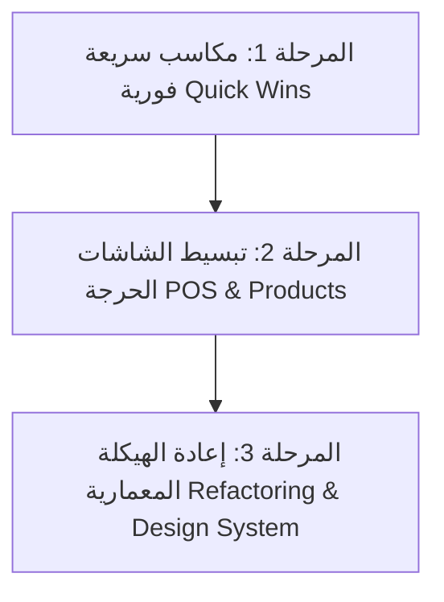

# تقرير التقييم والتحليل الشامل لواجهات وتجربة المستخدم (UI/UX & Frontend Architecture Audit)
**نظام إدارة مكتبة ومبيعات ومخازن سعود الشافعي**
*تاريخ التحليل: أكتوبر 2026*  
*إعداد: خبير هندسة واجهات المستخدم وتجربة الاستخدام (UI/UX & Frontend Specialist)*

---

## 1. الملخص التنفيذي (Executive Summary)

تم إجراء تدقيق هندسي وتصميمي شامل لواجهات المستخدم (UI)، وتجربة الاستخدام (UX)، وبنية الواجهة الأمامية (Frontend Architecture) لنظام مكتبة سعود الشافعي (`bookstore-erp` المبني بواسطة **Next.js 16 + React 19 + Tailwind CSS v4**).

### ملخص التقييم العام:
* **الهوية البصرية والجماليات الأولية:** 7.5 / 10 (هوية داكنة حديثة مع لمسات برتقالية أنيقة واستخدام للزجاج المعتم Glassmorphism).
* **سهولة وتدفق رحلة المستخدم (Frictionless UX):** 4.5 / 10 (إجراءات معقدة للغاية، شاشات عملاقة متراكمة، حقول زائدة ترهق المستخدم).
* **سرعة عمليات البيع والكاشير (POS Efficiency):** 4 / 10 (غياب اختصارات الكيبورد السريعة، نوافذ منبثقة إجبارية لاختيار الوحدات، والتحقق البطيء).
* **بنية الكود وتماسك المكونات (Frontend Architecture):** 4 / 10 (ظاهرة الـ Monolithic God Components بملفات تتخطى 1400 سطر، وتكرار الـ SideNav و TopNav في كل صفحة بشكل منفصل).
* **التوافقية والتباين وسهولة الوصول (A11y & Contrast):** 5 / 10 (ضعف التباين في النصوص الرمادية/الخوخية، مشاكل في الوضع الفاتح Light Mode).

---

## 2. المشاكل الهيكلية والمعمارية (Information Architecture & Layout)

### 2.1. غياب Layout موحد للأدمن (Layout Anti-Pattern)
* **المشكلة الحالية:**
  كل صفحة في مجلد `src/app/` (مثل `/pos`, `/inventory`, `/orders`, `/dashboard`, `/customers`...) تستدعي يدوياً وبشكل مستقل:
  ```tsx
  <SideNav />
  <TopNav title="..." />
  <main className="app-main ...">
  ```
* **الأثر السلبي على الـ UX والـ Frontend:**
  1. عند التنقل بين الصفحات، يتم هدم (Unmount) القائمة الجانبية والشريط العلوي بالكامل ثم إعادة بنائهما من الصفر، مما يسبب وميضاً بصرياً (Flickering).
  2. اضطر المطور لوضع حيلة برمجية في `SideNav.tsx`:
     ```ts
     let rememberedNavScrollTop = 0; // محاولة لحفظ موضع التمرير عبر المتغير العام
     ```
  3. إعادة طلب بيانات المستخدم الحالي وصلاحياته (`getCurrentUser()`) عند كل انتقال صفحة بدلاً من إدارتها على مستوى Root Layout / Auth Context.
* **الحل المقترح:**
  إنشاء مجموعة مسارات موحدة مثل `app/(admin)/layout.tsx` تحتضن `SideNav` و `TopNav` مرة واحدة كـ Shell ثابت، بينما يتغير فقط الـ `children`.

---

### 2.2. القائمة الجانبية المسطحة المزدحمة (SideNav Cognitive Overload)
* **المشكلة الحالية:**
  القائمة الجانبية تسرد **18 عنصراً متتالياً** في عمود واحد دون أي تقسيم أو تصنيف شجري (Flat un-categorized list):
  *(لوحة التحكم، نقطة البيع، الصندوق، الفواتير، المرتجعات، العملاء، المخزون، النقل والجرد، طلبات المنتجات، موافقات الجرد، التصنيفات، العروض، المشتريات، الموردين، واتساب، المالية، التقارير، سجل التدقيق)*.
* **الأثر السلبي:**
  - يضطر المستخدم للتمرير الرأسي داخل شريط تمرير ضيق جداً في السايدبار للوصول للتقارير أو المالية.
  - تشويش ذهني عالٍ للمستخدم اليومي، واختلاط المهام اليومية السريعة (البيع والفواتير) بالمهام الإدارية الشهرية (التقارير وسجل التدقيق).
* **الحل المقترح:**
  تجميع العناصر في مجموعات وظيفية منسدلة أو قابلة للطي (Collapsible Sections):
  1. **المبيعات والصندوق:** (نقطة البيع، الصندوق، الفواتير، المرتجعات، العملاء).
  2. **المخزون والمستودعات:** (المخزون، النقل والجرد، أوامر الشراء، الموردين، التصنيفات، العروض).
  3. **الموافقات والرقابة:** (طلبات المنتجات، موافقات الجرد، سجل التدقيق).
  4. **المالية والتقارير:** (لوحة التحكم، المالية، التقارير، واتساب، الإعدادات).

---

### 2.3. المسافات الثابتة القاتلة للتجاوب (Hardcoded Layout Offsets)
* **المشكلة الحالية في `globals.css`:**
  ```css
  .app-main {
    margin-right: 364px;
    margin-left: 32px;
    padding-top: 160px;
    padding-bottom: 64px;
  }
  .app-top-nav {
    position: fixed;
    left: 8px;
    right: 364px;
    top: 8px;
  }
  ```
* **الأثر السلبي:**
  على الشاشات المتوسطة وشاشات اللابتوب الصغيرة وأجهزة التابلت (بين 1024px و 1366px)، يؤدي اقتطاع `364px` الثابت من اليمين إلى حشر المحتوى الرئيسي في مساحة عرض ضيقة جداً لا تتجاوز 650-700px، مما يؤدي إلى تشوه الجداول وكسر البطاقات واللجوء لتمريرات أفقية غير مقبولة.
* **الحل المقترح:**
  الاعتماد على نظام Flexbox / CSS Grid حديث (مثلاً: `grid-cols-[auto_1fr]` أو شريط جانبي بعرض نسبي متجاوب `w-72` مع `calc(100% - 18rem)`).

---

### 2.4. ازدواجية وظيفة البحث في الشريط العلوي (TopNav Search Disconnect)
* **المشكلة الحالية:**
  - إذا كان المستخدم في صفحة الكاشير (`/pos`)، الضغط على شريط البحث في الأعلى يقوم بعمل Focus على حقل بحث مختلف في منتصف الشاشة!
  - في بقية الصفحات، البحث يقسم الصفحات إلى نوعين (`remoteSearch` و `localSearch`): بعض الصفحات يتطلب البحث فيها الضغط على Enter أو زر "بحث"، وبعضها يبحث تلقائياً بعد 150ms!
* **الأثر السلبي:**
  كسر النموذج الذهني الموحد (Mental Model) للمستخدم؛ لا يعرف متى يكتب فقط ومتى يلزمه الضغط على Enter، ولا يفهم سبب انتقال المؤشر فجأة لمنتصف الصفحة في شاشة الكاشير.
* **الحل المقترح:**
  توحيد سلوك البحث الشامل (Global Command Palette - مثل `Ctrl+K`) للبحث في الفواتير والمنتجات والعملاء من أي مكان في النظام بضغطة زر واحدة.

---

## 3. التحليل العميق لنقطة البيع (POS UX & Usability Friction)

شاشة نقطة البيع (`src/app/pos/page.tsx`) هي الشريان الأساسي لأي نظام مكتبة/مبيعات. هذا المكون يبلغ حجمه **1490 سطراً في ملف واحد (God Component)**، ويعاني من عدة عوائق تشغيلية خطيرة:

### 3.1. إجبار الكاشير على استخدام الفأرة وغياب اختصارات الكيبورد (No Fast Hotkeys)
* **المشكلة:**
  الكاشير في أوقات الذروة وازدحام طوابير الزبائن يحتاج لإنهاء المعاملة في 5 إلى 10 ثوانٍ دون لمس الفأرة. حالياً في النظام:
  - لا يوجد اختصار لتثبيت/دفع الفاتورة نقداً (مثل `F9` أو `NumPad Enter`).
  - لا يوجد اختصار للتنقل بين الكاش والدليفري والآجل.
  - لا يوجد اختصار لتعديل الكمية للصنف الأخير (مثل `+` أو `-` من لوحة الأرقام).
  - لا يوجد اختصار لإلغاء السلة أو تعليقها (مثل `F4`).
* **الأثر:**
  كل عملية بيع تتطلب من الكاشير رفع يده عن الكيبورد/الماسح، ومسك الفأرة، وتمرير المؤشر للضغط على الأزرار، مما يضاعف وقت خدمة الزبون ثلاث مرات على الأقل.

---

### 3.2. نافذة اختيار الوحدات المنبثقة الإجبارية (`pendingProduct` Modal Bottleneck)
* **المشكلة (في الكود السطور 1451-1469):**
  عندما يمسح الكاشير باركود صنف أو يبحث عن منتج له وحدات (قطعة، دستة، كرتونة)، يفتح النظام Modal منبثق يغطي الشاشة ويطلب اختيار الوحدة والسعر يدوياً ثم الضغط على "إضافة للسلة"!
* **الأثر:**
  1. مسح الباركود مخصص أساساً لإضافة الصنف فوراً؛ إذا توقف الماسح عند كل صنف ليطلب نافذة حوارية، فقد الماسح قيمته السريعة.
  2. كل باركود وحدة يجب أن يضيف الصنف وتلك الوحدة تلقائياً إلى السلة بنقرة واحدة (1-Click Addition) دون أي نوافذ حوارية تقطع تدفق العمل.

---

### 3.3. كابوس التحقق الصامت من البيع (Checkout Validation Hell)
* **المشكلة (السطور 846-862):**
  زر "إتمام البيع" يتعطل (Disabled) بناءً على شرط ترناري ضخم جداً (`checkoutBlock`):
  ```tsx
  const checkoutBlock = savingCustomer ? "جارٍ حفظ العميل" : ... :
    cart.length === 0 ? "أضف صنفًا إلى السلة" :
    !validDeliveryFee ? "اكتب رسوم التوصيل..." :
    isCreditSale && !selectedCustomer ? "اكتب رقم تليفون العميل..." :
    ...
  ```
* **الأثر على الكاشير:**
  - عندما يكون زر "إتمام البيع" غير مفعل، لا يظهر أي مؤشر أحمر أو تنبيه على الحقل المتسبب في التعطيل (مثل: حقل تاريخ الاستحقاق، أو رسوم التوصيل، أو وردية الصندوق).
  - يضطر الكاشير للبحث بعينيه عن سطر نصي رمادي صغير جداً (font-size: 11px) في أسفل يسار الشاشة لقراءة سبب المنع!
  - في بيئة البيع السريعة، يظن الكاشير أن السيستم "علق" أو توقف عن الاستجابة.

---

### 3.4. تعقيد إجراءات البيع الآجل (Overcomplicated Credit Sale Flow)
* **المشكلة:**
  عند اختيار "بيع آجل":
  1. يجبر الكاشير على إدخال المبلغ المسدد (حتى لو كان 0).
  2. يلزمه باختيار وسيلة تحصيل الباقي لاحقاً من قائمة منسدلة.
  3. يلزمه بتحديد تاريخ استحقاق دقيق للدفعة القادمة عبر منتقي تواريخ.
* **الأثر:**
  في المكتبات ومحلات التجزئة، البيع الآجل لزبون معروف ("سجلها على الحساب") يحدث في ثانية واحدة. إلزام الكاشير بتعبئة 4 حقول متتالية وتواريخ استحقاق في كل عملية يوقف طابور البيع تماماً. يجب جعل هذه البيانات خيارات افتراضية سريعة مع إمكانية التخطي.

---

### 3.5. حقول الكميات في السلة (Cart Quantity Stepper Glitches)
* **المشكلة (السطور 1251-1265):**
  حقل إدخال الكمية في كل صنف داخل السلة:
  ```tsx
  <input type="number" value={item.quantity} onChange={...} />
  ```
  عندما يريد الكاشير تغيير الكمية من 1 إلى 5 عن طريق الكتابة، بمجرد الضغط داخل الحقل والكتابة قد تصبح "15" أو "51" أو تفرغ القيمة فيصبح السطر صفراً ويحذف الصنف، بسبب دمج أزرار الزيادة/النقصان مع حقل رقمي بدون آلية `auto-select on click`.

---

## 4. شاشات إدارة المنتجات والمخزون (Product Management & Inventory)

لوحة إضافة منتج (`src/components/AddProductPanel.tsx`) تبلغ **55.3 كيلوبايت وأكثر من 1020 سطراً**، وتعد من أكثر الشاشات تعقيداً على المستخدم:

### 4.1. الإفراط في تعقيد هيكل التسعير (Pricing Tier Overkill)
* **المشكلة:**
  - تطلب الشاشة تحديد:
    1. تكلفة الشراء
    2. ضريبة القيمة المضافة
    3. هامش ربح المستهلك
    4. هامش ربح نصف الجملة
    5. هامش ربح الجملة
    6. هامش ربح سوبر الجملة
    7. هامش ربح كبار العملاء (VIP)
  - ثم لكل وحدة إضافية (دستة، كرتونة، باكتة)، يعاد توليد شبكة أسعار كاملة تحتوي على 5 حقول أسعار أخرى!
  - منتج يحتوي على 3 وحدات يتطلب ملء ومراجعة **18 حقلاً رقمياً للأسعار**!
* **الأثر على المستخدم:**
  - مدخل البيانات في المكتبة الذي يرغب فقط في تسجيل "كشكول سلك" بسعر 40 جنيه قطاعي و32 جنيه جملة يجد نفسه محاصراً بأسئلة محاسبية معقدة لا يحتاجها في 95% من أصنافه.
  - احتمالية وقوع أخطاء إدخال بشرية عالية جداً، ونفور الموظفين من إضافة أصناف جديدة.
* **الحل المقترح:**
  اعتماد مبدأ **التسعير التدريجي (Progressive Disclosure)**:
  - إظهار حقلين فقط افتراضياً: (سعر البيع، وسعر التكلفة).
  - وضع زر تبديل أنيق: `[+] خيارات التسعير المتقدم والجملة (B2B)` للمستخدم الذي يحتاج تسعيراً متعدد المستويات.

---

### 4.2. تجربة رفع الصور غير المكتملة
* **المشكلة:**
  حقل رفع صورة المنتج (`drag & drop area`) يأخذ حيزاً رأسياً ضخماً (أكثر من 200px) في الشاشة، ولا يوفر:
  - أداة قص الصور (Image Cropper) لضبط أبعاد أغلفة الكتب.
  - ضغط الصور تلقائياً في المتصفح قبل الرفع لحماية استهلاك الباندويث وسرعة التحميل.
  - إمكانية لصق رابط صورة مباشر من الإنترنت أو البحث بالباركود لجلب الغلاف تلقائياً.

---

### 4.3. مشكلة مكون الاختيار `ProductSelect.tsx` ومصيدة الـ 7 عناصر
* **المشكلة البرمجية الخطيرة المكتشفة في `ProductSelect.tsx` (السطور 37-40):**
  ```ts
  const searchable = allOptions.length > 7;
  const visibleOptions = searchable
    ? [...allOptions.filter(option => option.label.toLocaleLowerCase().includes(search.trim().toLocaleLowerCase())).slice(0, 7)]
    : allOptions;
  ```
* **الكارثة في تجربة المستخدم:**
  إذا كان لدى المكتبة 20 تصنيفاً أو 50 ماركة، وقام المستخدم بفتح القائمة المنسدلة:
  **النظام يعرض فقط أول 7 عناصر ويقتطع الباقي نهائياً عبر `.slice(0, 7)`!**
  حتى لو قام المستخدم بالتمرير للأسفل، لن تظهر بقية الخيارات إطلاقاً إلا إذا حزر المستخدم اسم التصنيف وكتبه في حقل البحث! هذا خطأ UX جسيم يمنع المستخدم من استكشاف خياراته.
* **الحل:**
  إلغاء `.slice(0, 7)` فوراً والسماح بالتمرير الحر (Virtual Scrolling / Scrollable Dropdown) لكافة العناصر بحد أقصى للارتفاع `max-h-60 overflow-y-auto`.

---

## 5. التصميم البصري، الثيمات، والتناسق (Visual Design, Theming & Accessibility)

### 5.1. كسر الوضع الفاتح (Broken Light Theme Overrides)
* **المشكلة:**
  بينما يدعم ملف `globals.css` وضعين (`dark` و `light`)، فإن العديد من الصفحات والمكونات تحتوي على كلاسات Tailwind صلبة داكنة (Hardcoded Dark Classes) مكتوبة مباشرة في JSX، مثل:
  - `bg-[#131313]`
  - `bg-[#1c1b1b]`
  - `bg-[#201f1f]`
  - `border-white/10`
  - `text-white`
  - `text-[#e5e2e1]`
* **النتيجة الكارثية في الـ Light Mode:**
  عند تفعيل الوضع الفاتح، تظهر بعض البطاقات بخلفية بيضاء ونصوص رمادية فاتحة غير مقروءة، بينما تبقى مربعات حوارية وبطاقات أخرى بخلفيات سوداء فاحمة مكسورة، مما يعطي انطباعاً بأن النظام غير مكتمل أو به أخطاء برمجية فادحة.
* **الحل:**
  الاعتماد الحصري على متغيرات CSS الدلالية (Semantic Tokens) بدلاً من الألوان الصلبة (مثلاً: استخدام `bg-surface`, `bg-surface-card`, `text-content`, `border-muted`).

---

### 5.2. أزمة التباين وسهولة القراءة (Contrast & Legibility Issues)
* **المشكلة:**
  يستخدم النظام اللون المشمشي الفاتح المحروق `#e2bfb0` مع درجات شفافية منخفضة في العناوين الفرعية والأوصاف:
  - `text-[#e2bfb0]/40`
  - `text-[#e2bfb0]/60`
  - `text-[#e2bfb0]/70`
* **الفحص البصري وفق معايير WCAG 2.1:**
  نسبة التباين (Contrast Ratio) للون `#e2bfb0/40` على خلفية `#131313` لا تتعدى **2.1:1**، في حين أن الحد الأدنى المطلوب للعين السليمة هو **4.5:1** (مستوى AA).
* **الأثر:**
  إجهاد بصري شديد للموظفين الذين يستخدمون النظام لمدة 8-10 ساعات يومياً، وصعوبة قراءة بيانات المنتجات والملاحظات في بيئات الإضاءة العالية داخل المكتبة.

---

### 5.3. الإفراط في تأثيرات الزجاج المعتم (Glassmorphism Performance Penalty)
* **المشكلة:**
  استخدام مكثف لفلاتر الضبابية الثقيلة:
  ```css
  .glass { backdrop-filter: blur(20px); }
  .glass-panel { backdrop-filter: blur(50px); }
  ```
* **الأثر:**
  معظم أجهزة الكاشير ونقاط البيع في المكتبات والمحلات هي أجهزة كمبيوتر اقتصادية أو شاشات Touch مدمجة بمواصفات متواضعة (Intel Celeron / Core i3 بدون كرت شاشة منفصل). تطبيق `backdrop-filter: blur(50px)` على قوائم طويلة وجداول متحركة يسبب هبوطاً حاداً في معدل الإطارات (FPS Drop)، مما يجعل حركة التمرير ثقيلة ويولد انطباعاً بالبطء.

---

### 5.4. عدم توحيد تنسيق الأرقام والعملات (Currency & Number Formatting Inconsistency)
* **المشكلة:**
  - في بعض الشاشات: `120.00 ج.م`
  - في شاشات أخرى: `١٢٠ ج.م` (أرقام مشرقية)
  - في شاشة المبيعات: `ج.م 120.00`
  - في نسبة الخصم: تارة رمز `%` بالإنجليزية، وتارة `٪` بالعربية.
* **الحل:**
  إنشاء مكون تنسيق قياسي موحد (Standard Price Formatter Component) يلتزم بنسق ثابت للأرقام والعملة في كامل أرجاء النظام.

---

## 6. رحلة المستخدم في بقية الأقسام (Other Functional Modules)

### 6.1. شاشة المرتجعات (`/returns`)
* **المشكلة:**
  - تشترط الشاشة البحث عن الفاتورة الأصلية أولاً، وإذا كانت الفاتورة قديمة أو ورقية أو بيعت بدون تسجيل عميل، يصبح من الصعب جداً استرجاع الصنف بسهولة.
  - التبديل بين "استرجاع نقدي" و"استبدال بصنف آخر" معقد ويتطلب خطوات متعددة للتحقق من فروق الأسعار.

### 6.2. شاشة الصندوق وإغلاق الوردية (`/cash-register`)
* **المشكلة:**
  - عند إغلاق الوردية، يطلب النظام إدخال "المبلغ الفعلي المعدود" كرقم واحد إجمالي.
  - **ما ينقص تجربة الكاشير (UX Gap):** الكاشير في نهاية اليوم يعد درجات النقدية (فئات: 200، 100، 50، 20، 10، 5، 1 جنيه). غياب جدول حاسبة الفئات النقدية (Cash Denomination Breakdown) يجبر الكاشير على استخدام آلة حاسبة خارجية، وهو ما يفتح الباب لأخطاء الحساب اليدوي.

### 6.3. شاشة النقل والجرد (`/stock-operations`)
* **المشكلة:**
  - الشاشة تدمج عمليتين مختلفتين تماماً في الواجهة: "تسجيل جرد المخزن" و"النقل بين المستودعات".
  - جدول الجرد يعتمد على نصوص توضيحية مطولة جداً في رؤوس الأعمدة، مما يسبب تكدس البيانات.
  - إرسال جلسة الجرد يطلب سبباً إجبارياً لأي فرق (أكثر من 3 أحرف)، ولكن إذا نسي الموظف كتابة السبب لا يتم التركيز التلقائي على حقل النص، بل يكتفي النظام برسالة تحذير عامة في الأعلى.

### 6.4. شاشة كشف حساب العملاء (`/customers`)
* **المشكلة:**
  - كشف حساب العميل والمديونيات موجود داخل Slide-over جانبي ينفتح فوق الصفحة، مع تقسيمات تبويب (تفاصيل، كشف حساب، مدفوعات، متابعات).
  - عند الرغبة في طباعة كشف الحساب أو إرساله للعميل عبر واتساب، لا توجد معاينة طباعة واضحة (Print Preview) منسقة لكشف الحساب مثل فواتير البيع.

---

## 7. خارطة طريق التحسين والتطوير الموصى بها (Prioritized Action Plan)

نظراً لأهمية الحفاظ على استقرار النظام وعدم كسر العمليات الحالية، تم تصنيف التوصيات إلى 3 مراحل عمل محددة:



### المرحلة 1: مكاسب سريعة وفورية (تنفذ خلال أيام قليلة دون مخاطرة)
1. **إصلاح قائمة `ProductSelect.tsx`:** إزالة `.slice(0, 7)` فوراً حتى تظهر كل التصنيفات والموردين للمستخدم مع تفعيل شريط التمرير الكامل.
2. **تحسين التباين البصري:** رفع شفافية النصوص الرمادية/الخوخية من `opacity-40` و `opacity-60` لتصبح واضحة ومريحة للعين (الامتثال لمعايير WCAG).
3. **توضيح أخطاء زر "إتمام البيع" في الـ POS:** بدلاً من النص الرمادي الصغير المخفي، إظهار رسالة بارزة ومتحركة، أو إبراز الحقل الناقص (مثل رسوم التوصيل أو تاريخ الاستحقاق) بحدود حمراء واضحة.
4. **تخفيف تأثيرات الـ Blur:** تقليل `backdrop-filter: blur(50px)` إلى `blur(8px)` أو إزالتها في الشاشات العادية لتسريع استجابة النظام على أجهزة الكاشير القديمة.

---

### المرحلة 2: تحسين تجربة الشاشات الأساسية (الكاشير والمنتجات)
1. **إضافة اختصارات الكيبورد لكاشير المبيعات (Keyboard-First POS):**
   - `F1` أو `/` للبحث الفوري عن الصنف.
   - `F9` أو `Ctrl+Enter` للإتمام السريع للبيع النقدي فوراً وطباعة الفاتورة.
   - `F4` لتعليق السلة / استرجاع السلال المعلقة.
   - `Esc` لإلغاء أو تفريغ السلة الحالية بعد التأكيد.
2. **إلغاء نافذة اختيار الوحدات المنبثقة (`pendingProduct` Modal):**
   - جعل الماسح الضوئي يضيف الوحدة المطابقة للباركود فوراً للسلة بنقرة واحدة (Zero-Modal Workflow).
   - توفير قائمة منسدلة صغيرة لتغيير الوحدة داخل سطر الصنف بالسلة لمن يرغب في التبديل السريع.
3. **تبسيط شاشة إضافة المنتج (Progressive Disclosure):**
   - تقسيم الشاشة إلى تبويبات مبسطة: (بيانات أساسية -> تسعير عادي -> وحدات وتفاصيل متقدمة اختياري).
   - إخفاء المستويات السعرية الخمسة خلف زر "توسيع خيارات التسعير بالجملة".
4. **إضافة حاسبة فئات النقدية لوردية الصندوق:**
   - جدول بسيط يتيح للكاشير كتابة عدد ورقات (200, 100, 50, 20...) ليحسب النظام الإجمالي تلقائياً ويقارنه بالرصيد المسجل.

---

### المرحلة 3: إعادة الهيكلة المعمارية وضمان الاستدامة (Architectural Excellence)
1. **بناء `AdminLayout` مشترك:**
   - نقل `SideNav` و `TopNav` إلى Layout موحد يمنع تكرارهما وإعادة تحميلهما في كل صفحة.
2. **تفكيك الملفات العملاقة (Deconstruct Monoliths):**
   - تقسيم `pos/page.tsx` (1490 سطر) إلى مكونات متخصصة: `PosCart`, `PosProductCatalog`, `PosCustomerBar`, `PosCheckoutDrawer`, `PosHeldCartsModal`.
   - تقسيم `AddProductPanel.tsx` (1020 سطر) إلى مكونات منفصلة: `BasicInfoStep`, `UnitsStep`, `PricingMatrix`.
3. **توحيد الـ Design System للوضع الفاتح والداكن:**
   - استبدال كافة الألوان الصلبة (`bg-[#1c1b1b]`) بمتغيرات CSS Tokens تدعم التبديل الفوري والنظيف بين السمتين دون أي تشوهات بصرية.

---

> **ملاحظة أمان وهندسة:**  
> بناءً على التعليمات الصريحة: **لم يتم إجراء أي تعديل أو مساس بأي من ملفات الكود البرمجي للمشروع**. هذا التقرير يمثل وثيقة مرجعية تقييمية وخارطة طريق تنفيذية جاهزة للتطبيق خطوة بخطوة عند اعتماد البدء في تحسين الواجهات.
